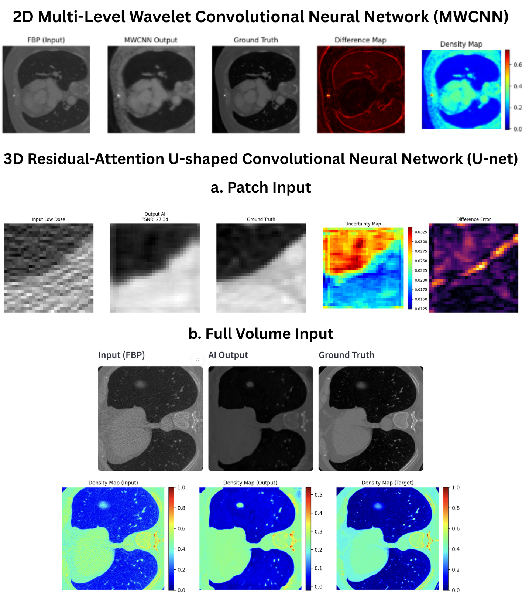

# Comparative Study of 2D and 3D Deep Learning for Low-Dose CT Denoising

## Project Overview
This project aims to enhance the image quality of **Low-Dose CT (LDCT)** scans, minimizing patient radiation exposure during lung cancer screening. We benchmarked **2D Multi-level Wavelet CNN (MWCNN)** against **3D Residual-Attention U-Net** to reconstruct high-fidelity images from noisy inputs.

**Dataset:** LoDoPaB-CT (Simulated Low-Dose from Normal-Dose CT).

## Methodology
We implemented and compared three denoising architectures, all taking the filtered back projection (FBP) reconstruction as input:
1.  **2D RED-CNN:** A residual encoder-decoder CNN (results in Section 3.3.2 of the full report).
2.  **2D MWCNN:** Utilizes wavelet transform for efficient feature extraction and noise suppression.
3.  **Lightweight 3D Residual-Attention U-Net:** A volumetric approach with attention gates, trained on 32×32×32 patches.

## Key Results
Our experiments revealed a significant trade-off between patch-based training accuracy and full-volume inference capability.

While the **3D model** performed well during patch-level testing, it suffered from domain shift issues when applied to full-volume patient scans because the model was trained on patch data. Consequently, the **2D MWCNN** turned out to be the robust solution.

| Metric | Input (FBP) | 2D MWCNN (Full Image) | 3D Res-Att U-Net (Full Volume) | 3D Res-Att U-Net (Patch Test) |
| :--- | :--- | :--- | :--- | :--- |
| **PSNR (dB)** | 16.78 | 22.88 | 16.58 | 28.60 |
| **SSIM** | 0.18 | 0.53 | 0.26 | 0.80 |
| **RMSE** | 0.147 | 0.074 | 0.148 | 0.030 |
| **CNR** | 1.28 | 2.24 | +2.92 (gain over input) | +7.15 (gain over input) |

*Values are taken from the full report: Table 3.6 (FBP input and 2D MWCNN), Table 3.4 (3D full volume, mean of 3 test volumes) and Table 3.3 (3D patch test, 8,118 patches). The FBP column refers to the MWCNN test set.*

> **Conclusion:** Although 3D patch testing shows high potential (PSNR 28.60 dB), the **2D MWCNN** is selected as the best model for full-image reconstruction in this study.

## Visual Comparison
Below is the comparison between:
1.  **2D MWCNN Output** (Balanced noise reduction & detail)
2.  **3D Patch Output** (High quality, limited FOV)
3.  **3D Full Volume Output** (Artifact issues)

*Figure 1: Visual comparison showing that 2D MWCNN provides the most consistent full-image restoration, whereas 3D Full Volume suffers from reconstruction artifacts despite high patch-level scores.*

## Documentation (Full Report)
The comprehensive research report is available in Indonesian. It covers detailed mathematical derivations, architecture diagrams, and extensive testing data.

**[Download Full Report (Bahasa Indonesia)](Full_Report_Indonesian.pdf)**

## Code Implementation
You can view the full training and testing process in the Jupyter Notebook below:

**[View Code Notebook (.ipynb)](Python_Script.ipynb)**

## Tech Stack
* **Language:** Python
* **Deep Learning Framework:** PyTorch
* **Libraries:** NumPy, Matplotlib, Scikit-image, PyWavelets

## Contributors
* **Crystaly**
* **Mutiara Putri Afrita**
* **Raisa Shahira Afnan**
* **Athallah Fadhil**

---
*This project was conducted as a Final Project for the Medical Imaging Technology Course at Biomedical Engineering Study Program, Department of Electrical Engineering, Universitas Indonesia.*
